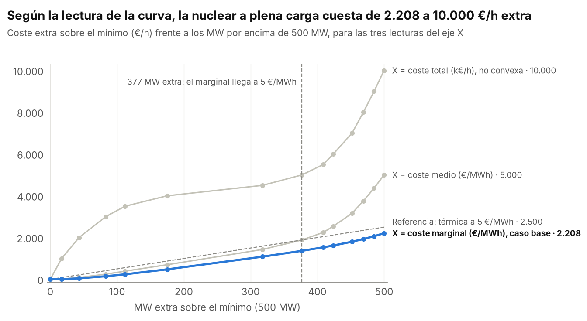

# Caso Red Eléctrica: formulación del modelo

*Capítulo 4 de la memoria (v10), copiado aquí para leer el código junto a la formulación. Cada restricción (R1)…(R11) lleva la misma etiqueta en los comentarios de `modelo.py`. Las referencias a tablas, apartados y capítulos son las de la memoria.*

## 4 Modelo matemático

### 4.1 Introducción

Este capítulo formula el modelo a partir del análisis del capítulo 2 y de las decisiones justificadas en el capítulo 3. Se trata de un MILP que minimiza el coste diario de operación en 24 periodos horarios, con la notación de la asignatura: DATOS en mayúsculas y variables en minúsculas. Se presentan, por orden, los conjuntos, los datos, las variables, la función objetivo, las restricciones y las alternativas de formulación.

### 4.2 Conjuntos e índices

La Tabla 4 define los conjuntos e índices del modelo.

Tabla 4  
*Conjuntos e índices del modelo*

| Símbolo                                                    | Descripción                                                                                            |
|------------------------------------------------------------|--------------------------------------------------------------------------------------------------------|
| $t \in T = \{ 0,\ldots,23\}$                               | Horas; $\tau \in \{ 0,\ldots,24\}$ para el nivel del depósito                                          |
| $n \in N$                                                  | Nodos de la red: centros 1–5 y centrales A–F                                                           |
| $l \in L$                                                  | Líneas, con extremos $\left( i_{l},j_{l} \right)$                                                      |
| $G^{T} = \{ A,C,F\}$, $G^{N} = \{ D\}$, $G^{H} = \{ B,E\}$ | Centrales térmicas, nuclear e hidráulicas; $G = G^{T} \cup G^{N} \cup G^{H}$; $g \in G$, $h \in G^{H}$ |
| $k \in K$                                                  | Puntos de ruptura de la curva nuclear                                                                  |
| $n \in N^{X} = \{ 1,5\}$                                   | Nodos con conexión exterior                                                                            |

*Nota.* Elaboración propia.

### 4.3 Datos

La Tabla 5 recoge los datos (parámetros) del modelo junto con sus unidades.

Tabla 5  
*Datos del modelo*

| Símbolo                                     | Descripción                                                                                                       | Unidad           |
|---------------------------------------------|-------------------------------------------------------------------------------------------------------------------|------------------|
| ${DEM}_{n,t}$, ${DMAX}_{n}$, ${PERFIL}_{t}$ | Demanda del nodo $n$ en la hora $t$: ${DMAX}_{n} \cdot {PERFIL}_{t}/100$ (demanda máxima por perfil horario en %) | MW               |
| ${PMIN}_{g}$, ${PMAX}_{g}$                  | Mínimo y máximo técnico                                                                                           | MW               |
| ${CMIN}_{g}$, ${CEXTRA}_{g}$, ${CARR}_{g}$  | Coste horario al mínimo, coste por MWh extra y coste de arranque                                                  | €/h, €/MWh, €    |
| ${PH}_{h}$, ${CH}_{h}$, ${DESC}_{h}$        | Potencia fija, coste horario y descenso del depósito de cada hidráulica                                           | MW, €/h, m/h     |
| ${PBOMBA}_{h}$                              | Potencia máxima de bombeo de cada hidráulica (solo V4)                                                            | MW               |
| $EB = 3.300$                                | Energía para subir 1 m de agua                                                                                    | MWh/m            |
| $HMIN = 10$, $HMAX = 20$, $H0 = 10$         | Límites y nivel inicial del depósito (H2)                                                                         | m                |
| ${CAP}_{l}$                                 | Capacidad de cada línea                                                                                           | MW               |
| $Y_{k}$, ${CD}_{k}$                         | MW extra y coste extra en cada punto de ruptura de la curva nuclear                                               | MW, €/h          |
| ${PC}_{t}$, ${PV}_{t}$, ${CAPX}_{n}$        | Precio de compra, precio de venta y capacidad de intercambio (H7)                                                 | €/MWh, MW        |
| $PEOL$, ${FV}_{t}$, $CEOL$                  | Potencia eólica instalada, factor de capacidad horario y coste variable (análisis 5, H9)                          | MW, p. u., €/MWh |
| $R = 0,15$                                  | Fracción de reserva                                                                                               | Adimensional     |
| ${FE}_{g}$, $\varepsilon$, $PCO2$           | Factor de emisión (H3), tope de emisiones y precio del CO₂                                                        | t/MWh, t, €/t    |
| $CENS$, $CRES$                              | Penalización de la demanda no servida y del déficit de reserva                                                    | €/MWh, €/MW·h    |

*Nota.* Elaboración propia con datos del enunciado del caso (Maheut, 2026).

### 4.4 Variables

La Tabla 6 define las variables de decisión y su dominio.

Tabla 6  
*Variables de decisión*

| Variable                                                                                   | Dominio                                            | Significado                                                                                       |
|--------------------------------------------------------------------------------------------|----------------------------------------------------|---------------------------------------------------------------------------------------------------|
| $u_{g,t}$                                                                                  | $\{ 0,1\}$                                         | 1 si la central $g$ está en marcha en la hora $t$                                                 |
| $s_{g,t}$                                                                                  | $\lbrack 0,1\rbrack$                               | 1 si la central arranca en $t$; es entera en el óptimo porque $u$ lo es y el objetivo la minimiza |
| $p_{g,t}$                                                                                  | $\geq 0$                                           | Potencia de las térmicas y la nuclear                                                             |
| $\lambda_{k,t}$                                                                            | $\geq 0$                                           | Pesos de la curva nuclear                                                                         |
| $z_{k,t}$                                                                                  | $\{ 0,1\}$                                         | Segmento activo de la curva (SOS2); solo si la curva no es convexa                                |
| $b_{h,t}$                                                                                  | $\geq 0$                                           | Potencia de bombeo                                                                                |
| $w_{h,t}$                                                                                  | $\{ 0,1\}$                                         | 1 si la hidráulica *h* bombea en la hora *t* (solo V4)                                            |
| ${\mathit{n}\mathit{i}\mathit{v}}_{\tau}$                                                  | $\lbrack 10,20\rbrack$                             | Nivel del depósito en el instante $\tau$                                                          |
| $f_{l,t}$                                                                                  | $\left\lbrack - {CAP}_{l},{CAP}_{l} \right\rbrack$ | Flujo por la línea, positivo de $i_{l}$ a $j_{l}$                                                 |
| $c_{n,t}$, $v_{n,t}$                                                                       | $\left\lbrack 0,{CAPX}_{n} \right\rbrack$          | Compra y venta exterior                                                                           |
| ${\mathit{p}\mathit{e}}_{t}$                                                               | $\lbrack 0,\ PEOL \cdot {FV}_{t}\rbrack$           | Producción eólica (análisis 5)                                                                    |
| ${\mathit{e}\mathit{n}\mathit{s}}_{n,t}$, ${\mathit{r}\mathit{d}\mathit{e}\mathit{f}}_{t}$ | $\geq 0$                                           | Demanda no servida y déficit de reserva; solo en el modo de diagnóstico                           |

*Nota.* Elaboración propia.

### 4.5 Función objetivo

La función objetivo minimiza el coste diario de operación. Este coste incluye los costes horarios al mínimo, el coste del tramo por encima del mínimo, el coste extra de la nuclear, el coste horario de las hidráulicas, los arranques y el saldo del intercambio exterior:

$$\min z = \sum_{t \in T}^{}{\sum_{g \in G^{T}}^{}\left( {CMIN}_{g}\, u_{g,t} + {CEXTRA}_{g}\,\left( p_{g,t} - {PMIN}_{g}\, u_{g,t} \right) \right)} + \sum_{t \in T}^{}{\sum_{g \in G^{N}}^{}\left( {CMIN}_{g}\, u_{g,t} + \sum_{k}^{}{CD}_{k}\,\lambda_{k,t} \right)}$$

$$+ \sum_{t \in T}^{}{\sum_{h \in G^{H}}^{}{CH}_{h}}\, u_{h,t} + \sum_{t \in T}^{}{\sum_{g \in G}^{}{CARR}_{g}}\, s_{g,t} + \sum_{t \in T}^{}{\sum_{n \in N^{X}}^{}\left( {PC}_{t}\, c_{n,t} - {PV}_{t}\, v_{n,t} \right)}$$

El coste fijo solo se paga si la central está en marcha. Se trata de la linealización de una función discontinua con una binaria vista en la sesión 030, que aquí no requiere una M grande, porque la cota natural es ${PMAX}_{g}$.

### 4.6 Restricciones

La restricción (R1) impone el balance de potencia en cada nodo, de acuerdo con la ley de Kirchhoff de corrientes aplicada a un modelo de transporte. La generación del nodo es $p$ en las térmicas y la nuclear, $PH \cdot u - b$ en las hidráulicas y $c - v$ en los nodos exteriores:

$$\text{gen}_{n,t} + \sum_{l:\, j_{l} = n}^{}f_{l,t} - \sum_{l:\, i_{l} = n}^{}f_{l,t} = {DEM}_{n,t}\quad\quad\forall n \in N,\ t \in T$$

La restricción (R2) limita la potencia de las térmicas y la nuclear según estén en marcha:

$${PMIN}_{g}\, u_{g,t} \leq p_{g,t} \leq {PMAX}_{g}\, u_{g,t}\quad\quad\forall g \in G^{T} \cup G^{N},\ t \in T$$

La restricción (R3) define los arranques. El índice $t - 1$ es cíclico (H5), de modo que la hora 23 precede a la hora 0:

$$s_{g,t} \geq u_{g,t} - u_{g,t - 1}\quad\quad\forall g \in G,\ t \in T$$

La restricción (R4) representa la curva de coste de la nuclear como una función lineal a tramos. Si la curva es convexa, al minimizar, el modelo activa por sí solo dos puntos adyacentes y no hacen falta binarias (sesión 030, programación separable); si no lo es, se añade la condición SOS2 con una binaria por segmento. La variable $z_{k,t}$ representa el segmento entre los puntos $k - 1$ y $k$; por convenio, $z_{0,t} = z_{|K|,t} = 0$.

$$p_{D,t} = {PMIN}_{D}\, u_{D,t} + \sum_{k}^{}Y_{k}\,\lambda_{k,t},\quad\quad\sum_{k}^{}\lambda_{k,t} = u_{D,t}$$

$$\text{SOS2: }\ \sum_{k \geq 1}^{}z_{k,t} = u_{D,t},\quad\quad\lambda_{k,t} \leq z_{k,t} + z_{k + 1,t}\quad\quad\forall k,\ t$$

La Figura 4 muestra la curva digitalizada, formada por 14 puntos, y sus tres lecturas posibles (H4). Con la lectura marginal del caso base, la nuclear resulta más barata que una térmica hasta unos 377 MW extra. Sin embargo, con la lectura de coste total la curva es cóncava en los primeros MW, por lo que el modelo necesita SOS2 y la nuclear deja de ser competitiva por encima del mínimo (apartado 7.6).

Figura 4  
*Coste extra de la nuclear según la lectura de la curva*

*Nota.* Elaboración propia con datos del enunciado del caso (Maheut, 2026).

La restricción (R5) se refiere al bombeo. El bombeo $b$ de cada hidráulica es una variable continua no negativa. Dado que el enunciado no limita su potencia ni prohíbe bombear y turbinar a la vez, se ha elegido la formulación más simple (H6) y no se añade ninguna restricción propia. Así, el bombeo consume potencia en el nodo de la central (R1) y solo lo limitan las líneas que llegan a B y E. La versión V4 (apartado 4.7) añade el modo de funcionamiento mediante una binaria $w_{h,t}$, con $u_{h,t} + w_{h,t} \leq 1$ y $b_{h,t} \leq {PBOMBA}_{h}\, w_{h,t}$, y, como el depósito es compartido (H1), impide bombear con una central mientras turbina la otra: $w_{B,t} + u_{E,t} \leq 1$ y $w_{E,t} + u_{B,t} \leq 1$.

La restricción (R6) expresa el balance del depósito, que empieza y acaba el día con al menos 10 m (H2):

$${\mathit{n}\mathit{i}\mathit{v}}_{t + 1} = {\mathit{n}\mathit{i}\mathit{v}}_{t} - \sum_{h \in G^{H}}^{}{DESC}_{h}\, u_{h,t} + \frac{1}{EB}\sum_{h \in G^{H}}^{}b_{h,t}\quad\quad\forall t \in T$$

$${\mathit{n}\mathit{i}\mathit{v}}_{0} = H0,\quad\quad{\mathit{n}\mathit{i}\mathit{v}}_{24} \geq H0,\quad\quad HMIN \leq {\mathit{n}\mathit{i}\mathit{v}}_{\tau} \leq HMAX\quad\forall\tau \in \{ 0,\ldots,24\}$$

La restricción (R7) impone la reserva del 15 %. En cada hora, la potencia que se puede movilizar debe cubrir un aumento del 15 % de la demanda. Según el enunciado, esta potencia está formada por el margen de las centrales en marcha, las hidráulicas paradas que pueden arrancar (aunque el depósito baje de 10 m) y el bombeo que se puede interrumpir:

$$\sum_{g \in G^{T} \cup G^{N}}^{}\left( {PMAX}_{g}\, u_{g,t} - p_{g,t} \right) + \sum_{h \in G^{H}}^{}{PH}_{h}\,\left( 1 - u_{h,t} \right) + \sum_{h \in G^{H}}^{}b_{h,t}\  \geq \ R\sum_{n \in N}^{}{DEM}_{n,t}\quad\quad\forall t \in T$$

La restricción (R8) limita la capacidad de las líneas y del intercambio, $\left| f_{l,t} \right| \leq {CAP}_{l}$ y $c_{n,t},v_{n,t} \leq {CAPX}_{n}$. Ambas condiciones se imponen como cotas de las variables, por lo que no añaden filas al modelo (sesión 020).

La restricción (R9) recoge las emisiones, que se analizan en el capítulo 9. Al tratarse de una expresión lineal del modelo, pueden limitarse mediante una restricción (método de las ε-restricciones) o valorarse en el objetivo sumando $PCO2 \cdot EM$:

$$EM = \sum_{t \in T}^{}\left\lbrack \sum_{g \in G^{T} \cup G^{N}}^{}{FE}_{g}\, p_{g,t} + \sum_{h \in G^{H}}^{}{FE}_{h}\,{PH}_{h}\, u_{h,t} \right\rbrack\  \leq \ \varepsilon$$

La restricción (R10) diagnostica escenarios imposibles (capítulo 8). Se suma ${\mathit{e}\mathit{n}\mathit{s}}_{n,t}$ a la generación de cada centro en (R1) y ${\mathit{r}\mathit{d}\mathit{e}\mathit{f}}_{t}$ al primer miembro de (R7), y el objetivo añade $\sum_{n,t}^{}{CENS} \cdot {\mathit{e}\mathit{n}\mathit{s}}_{n,t} + \sum_{t}^{}{CRES} \cdot {\mathit{r}\mathit{d}\mathit{e}\mathit{f}}_{t}$, con $CENS = 10.000$ €/MWh y $CRES = 1.000$ €/MW·h. Así, un escenario sin solución muestra cuánta demanda y reserva faltan, y dónde.

Por último, la restricción (R11) solo se activa en el análisis 5, en el que la nuclear se sustituye por un parque eólico en el nodo de D. En ese caso $G^{N} = \emptyset$, la generación del nodo D en (R1) pasa a ser ${\mathit{p}\mathit{e}}_{t}$ y la producción eólica queda limitada por el viento disponible:

$$0 \leq {\mathit{p}\mathit{e}}_{t} \leq PEOL \cdot {FV}_{t}\quad\quad\forall t \in T$$

La diferencia $PEOL \cdot {FV}_{t} - {\mathit{p}\mathit{e}}_{t}$ es la energía vertida. El objetivo suma $\sum_{t \in T}^{}{CEOL} \cdot {\mathit{p}\mathit{e}}_{t}$, nulo en este trabajo (H9), y las emisiones suman $\sum_{t \in T}^{}{FE}_{eol} \cdot {\mathit{p}\mathit{e}}_{t}$. La eólica no entra en (R7), porque no aporta reserva firme.

### 4.7 Alternativas de formulación

El modelo incluye cuatro alternativas de formulación, seleccionables como parámetro, que el apartado 7.5 compara con cuatro criterios: exactitud, tamaño, tiempo de resolución e interpretabilidad. La curva de la nuclear puede tratarse con la formulación convexa sin binarias (caso base) o con un conjunto SOS2 y binarias (V3), y la red, con el modelo de transporte (caso base) o como nudo único (V1).

La reserva puede exigirse a todo el sistema (caso base) o suprimirse (V2). Una variante adicional, usada en la validación (capítulo 6), exige que la reserva pueda llegar por la red mediante un despacho de emergencia horario con la demanda multiplicada por 1,15. Por último, el bombeo puede ser libre (caso base) o estar limitado a la potencia de la central y sin turbinar a la vez (V4). Además, el modelo ofrece dos opciones para el diagnóstico y el impacto ambiental: la penalización de la demanda no servida y del déficit de reserva (R10, capítulo 8) y el tope de emisiones o el precio del CO₂ (R9, capítulo 9).

### 4.8 Conclusiones

En conclusión, el modelo tiene diez bloques de restricciones, más el de la eólica del análisis 5. Los costes fijos y los arranques se linealizan con binarias sin M grande, y la curva de la nuclear se trata como función lineal a tramos, con o sin SOS2 según sea convexa o no. Cada decisión de formulación tiene al menos una alternativa programada, lo que permite medir su efecto en el capítulo 7. El capítulo 5 explica cómo se ha implementado.

